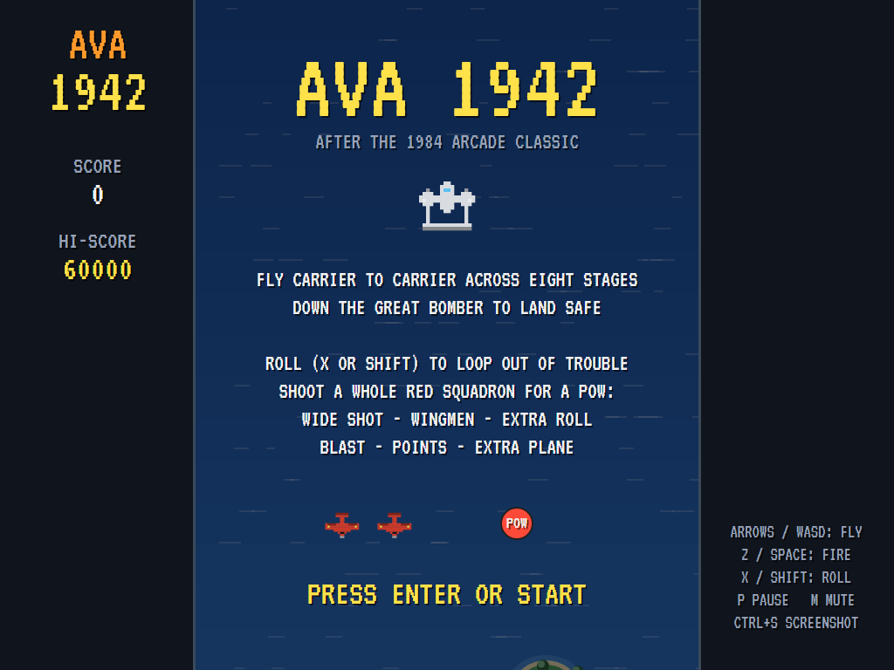
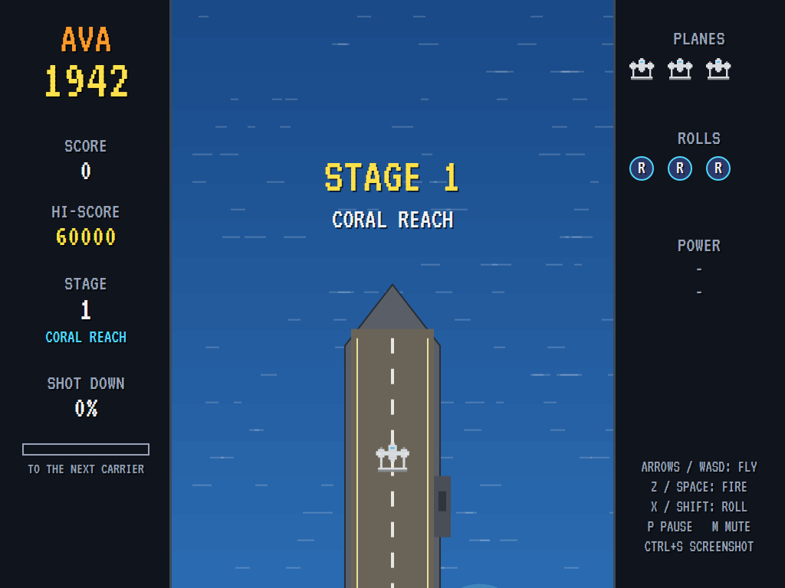
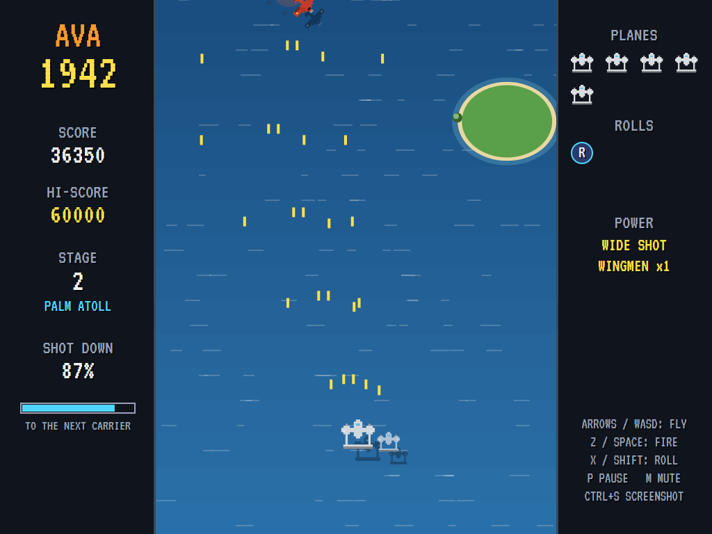
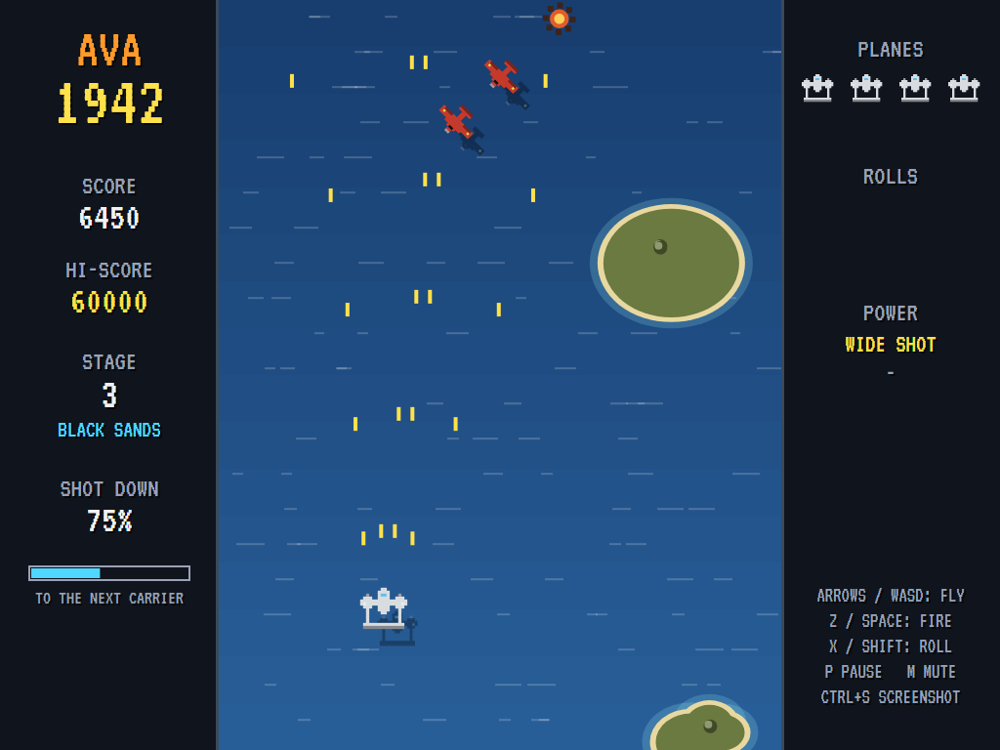
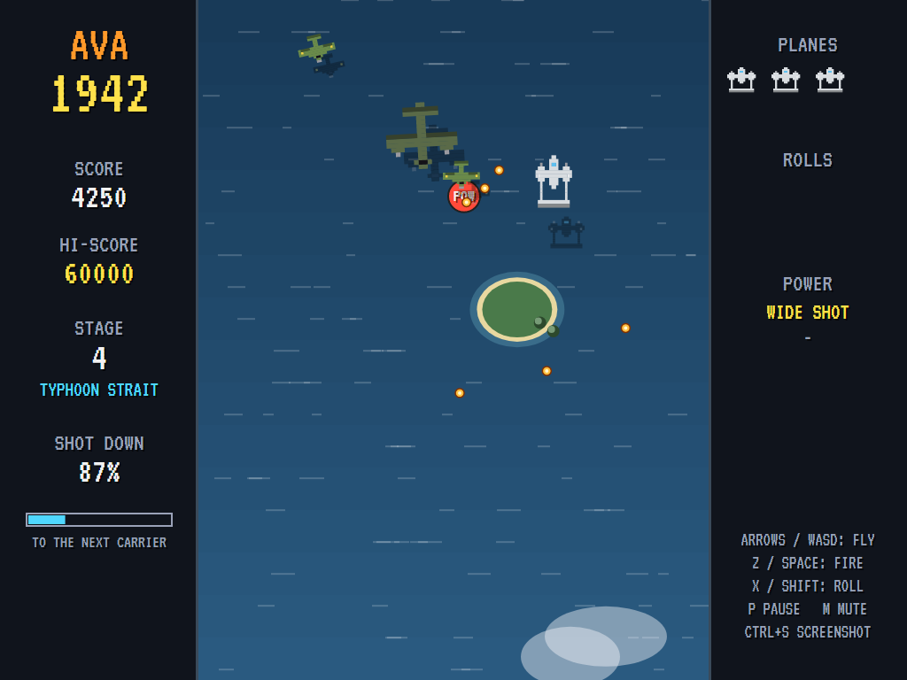
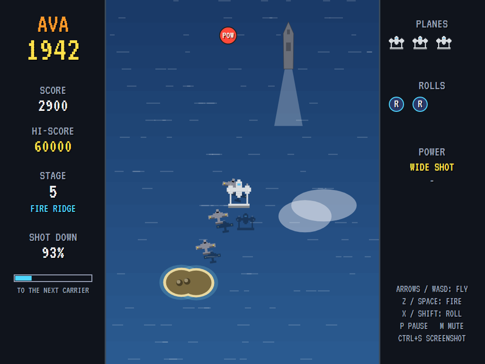
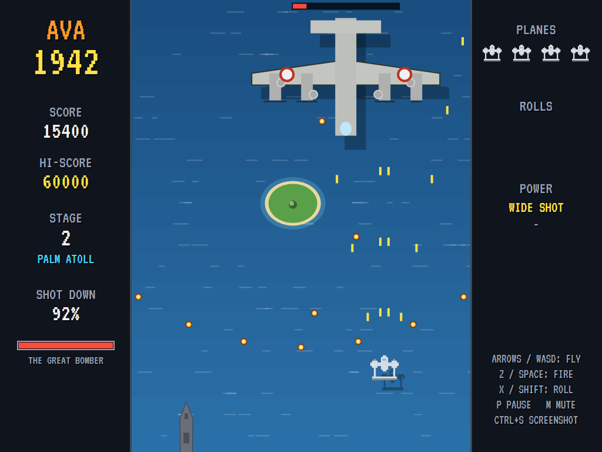
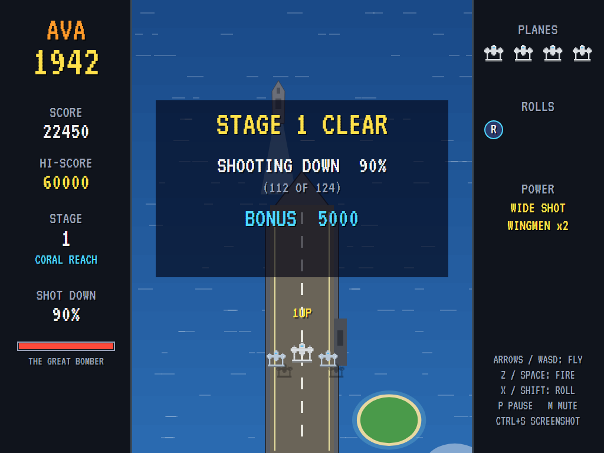
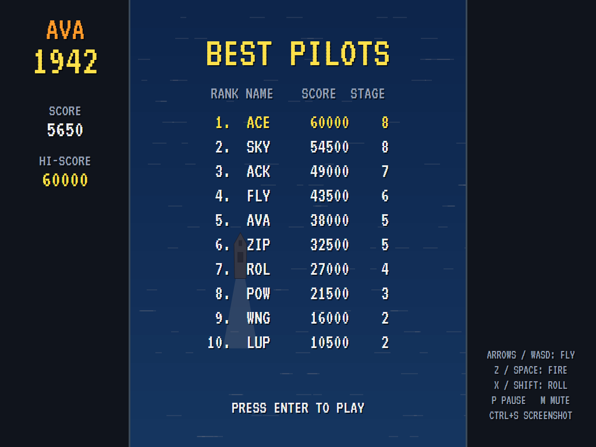

# AVA1942

[](https://github.com/Harlock123/AVA1942/actions/workflows/build.yml)

A vertical-scrolling air-war shooter in the style of Capcom's 1984 arcade game **1942**, built with
.NET 10 and Avalonia UI. Take off from a carrier, fight your way up the ocean through waves of fighters,
squadrons and bombers, bring down the great bomber at the end, and land on the next carrier. Do it
eight times over.

## Features

- **Carrier to carrier**: every stage starts with a take-off from a carrier deck and ends with a landing
  on the next one, then a tally of how many of the enemy you shot down and the bonus it earns. Shoot
  them all for a **perfect**.
- **Eight stages**, each with its own stretch of ocean, from Coral Reach to Last Light. Each one is
  longer, busier and fiercer than the last. After the eighth they come round again, harder still.
- **The enemy**:
  - **Fighters** in waves that dive, loop round and climb away, or cross the screen.
  - **Diving fighters** aimed straight at where you are.
  - **Grey fighters** that climb up past you from behind.
  - **Red squadrons** snaking down the screen. Shoot all five and a **POW** drops.
  - **Medium bombers**: tough, slow, and spraying shot.
  - **The great bomber** at the end of each stage: four engines, four gun turrets, and fans of fire.
- **The roll**: three loop-the-loops per stage (X or Shift). Nothing can touch you while you're
  looping, but you can't fire either.
- **Power-ups** from the red squadrons:
  - **Wide shot**: four guns instead of two.
  - **Wingmen**: two escorts who fly and fire alongside you, and each take a hit for you.
  - **Extra roll**, and **blast**, which brings down everything on the screen.
  - **Points**, and now and then **an extra plane**.

  Losing a plane loses the wide shot and the wingmen.
- **The ocean below** scrolls past with its swell, islands with their beaches and palms, ships and
  their wakes, and clouds drifting over the top. Every plane casts a shadow on the sea.
- **Sound**: an original flying march over the engines' drone, the guns, explosions, the roll, the
  power-ups, the warning siren and the stage-clear tune, all mixed by OpenAL.
- **Attract mode**: leave the title alone for 15 seconds and a computer pilot flies a demonstration.
  It slides away from shots and planes (rolling if it must), collects power-ups, and lines up under
  the enemy. The tests make it fly the first two stages through.
- **A top-ten high-score table** with arcade-style initials entry; it records the stage reached.
- **Gamepads** through SDL2, as well as the keyboard.
- **Any window size**: the screen scales to fit, letterboxed. **Ctrl+S** saves a screenshot.
- **One self-contained executable** per platform: Windows, macOS and Linux on Intel/AMD and ARM.

## Screenshots

| The title | Take-off | Into battle |
|:---------:|:--------:|:-----------:|
|  |  |  |
| Carrier to carrier, eight stages. | Off the carrier deck. | Wide shot and a wingman. |

| A red squadron | A medium bomber | The roll |
|:--------------:|:---------------:|:--------:|
|  |  |  |
| Get all five for a POW. | It takes a lot of shooting. | Looping out of trouble. |

| The great bomber | Stage clear | The best pilots |
|:----------------:|:-----------:|:---------------:|
|  |  |  |
| The end of the stage. | Landed, and the tally. | The high-score table. |

The screenshots are made by the tests, which play the game in a real (headless) window; see
[Tests](#tests).

## Download and run

Ready-to-run builds for Windows, macOS and Linux, on both Intel/AMD and ARM, are on the
[Releases page](https://github.com/Harlock123/AVA1942/releases/tag/latest). **Latest build** is
rebuilt on every push to `main`. Each download is one self-contained executable: no .NET install is
needed.

| Platform | Archive |
|---|---|
| Windows | `AVA1942-win-x64.zip`, `AVA1942-win-x86.zip`, `AVA1942-win-arm64.zip` |
| macOS | `AVA1942-osx-arm64.tar.gz` (Apple silicon), `AVA1942-osx-x64.tar.gz` (Intel) |
| Linux | `AVA1942-linux-x64.tar.gz`, `AVA1942-linux-arm64.tar.gz`, `AVA1942-linux-arm.tar.gz` |

```bash
tar -xzf AVA1942-linux-x64.tar.gz     # or linux-arm64, linux-arm, osx-arm64, osx-x64
./AVA1942
```

On Windows, unzip and run `AVA1942.exe`. On macOS, if Gatekeeper refuses to open it, run
`xattr -d com.apple.quarantine AVA1942` once. Run with `--no-audio` for silence.

**Sound** comes through OpenAL Soft, built in for every platform. In a virtual machine the game
detects it and uses a larger audio buffer, so the sound doesn't break up.

**Gamepads** use SDL2, which is bundled for Windows, macOS and Intel/AMD Linux. ARM Linux builds need it
installed; without it the keyboard still works:

```bash
sudo apt install libsdl2-dev            # Debian / Ubuntu / Raspberry Pi OS
sudo pacman -S --needed sdl2-compat     # Arch / Omarchy
```

## Controls

| Input | Action |
|-------|--------|
| **Enter** / **Space** | Start |
| **Arrow keys** / **WASD** / number pad | Fly, eight ways |
| **Z** / **Space** / **Ctrl** (hold) | Fire |
| **X** / **Shift** | Roll (a loop-the-loop) |
| **P** / **Esc** | Pause (Esc again to quit) |
| **M** | Mute |
| **Ctrl+S** / **Cmd+S** | Save a screenshot to the Pictures folder |

**Gamepad**: left stick or D-pad to fly, **A** to fire, **B** or **Y** to roll, **Start** to start and
pause, **Back** (while paused) to quit.

**Entering initials**: type letters, or dial with **Up**/**Down** and accept with **Space**; **Left** /
**Backspace** go back; **Enter** finishes.

## Scoring

| What | Points |
|---|---:|
| A fighter, a red or grey fighter | 50, 100 |
| A medium bomber | 1,000 |
| The great bomber | 5,000 + 1,000 × the stage |
| A POW | 500 (points POW: 1,500) |
| The stage tally | 50 × the percentage shot down, 10,000 more for a perfect, 500 a roll left |
| Extra plane | at 20,000, then every 70,000 |

## Tests

```bash
dotnet test AVA1942.slnx
```

The engine has no UI and runs in fixed 60 Hz steps, so it plays the same at any frame rate, and a seed
always plays the same game. The tests check:

- **The stage**: the take-off, flying eight ways within the screen, and twin guns or four with the wide
  shot.
- **The enemy**: fighters and bombers taking their hits, a whole red squadron dropping a POW (and one
  escaping meaning none), and waves of every kind arriving by themselves.
- **Power-ups**: every POW, wingmen firing and taking a hit, and the roll carrying the plane through
  anything.
- **The end of the stage**: the great bomber coming and the landing and the tally, perfect bonus and
  all.
- **The machine**: lives and extra planes, game over and the high-score table, the stages coming round
  again, the title, demo and table cycle, pausing, and every sound and sprite.

The computer pilot must fly the first two stages through with three different seeds.

The screenshot tests draw the real screen in a headless window. To refresh the README's pictures:

```bash
AVA1942_SHOTS=$PWD/Images dotnet test tests/AVA1942.Tests --filter ScreenshotTests
```

## Building

```bash
dotnet build AVA1942.slnx
dotnet run --project src/AVA1942
```

Needs the .NET 10 SDK. The sounds are made by `tools/make_sounds.py` (standard-library Python):
`python3 tools/make_sounds.py` rewrites `src/AVA1942/Sounds`.

## Project structure

```
AVA1942/
├── AVA1942.slnx
├── src/AVA1942/
│   ├── Engine/
│   │   ├── GameEngine.cs        # States, the title and demo cycle, lives and the music
│   │   ├── GameEngine.Play.cs   # Flying, shooting and rolling, the waves and their flight paths,
│   │   │                        # squadrons and POWs, bombers, the great bomber, landing and the tally
│   │   ├── Stages.cs            # The eight stages: their seas, lengths, speeds and fire
│   │   ├── Entities.cs, Geometry.cs
│   │   ├── AttractPilot.cs      # The computer pilot for the demonstration (and the tests)
│   │   ├── HighScoreTable.cs, InitialsEntry.cs
│   │   ├── InputHandler.cs, ControllerManager.cs  # Keys and an SDL2 gamepad
│   │   └── SoundManager.cs      # Effects, the flying music and the tunes through OpenAL
│   ├── Audio/                   # The OpenAL engine (from the author's AVABand)
│   ├── Views/                   # The sea, islands, ships, carriers, planes and the panels
│   └── Sounds/                  # The synthesised effects and tunes
├── tests/AVA1942.Tests/         # Gameplay and screenshot tests
├── tools/make_sounds.py
└── Images/                      # Screenshots
```

## About and licence

AVA1942 © 2026 Lonnie Watson, under the [MIT License](LICENSE).

*1942* © 1984 Capcom; the name belongs to its current owner. AVA1942 is an independent, unofficial game
in its style. Its stages, planes, graphics, sounds, tunes and code are its own; nothing is taken from
the arcade machine's program, graphics, sound or music. It is not affiliated with or endorsed by any
rights holder.
